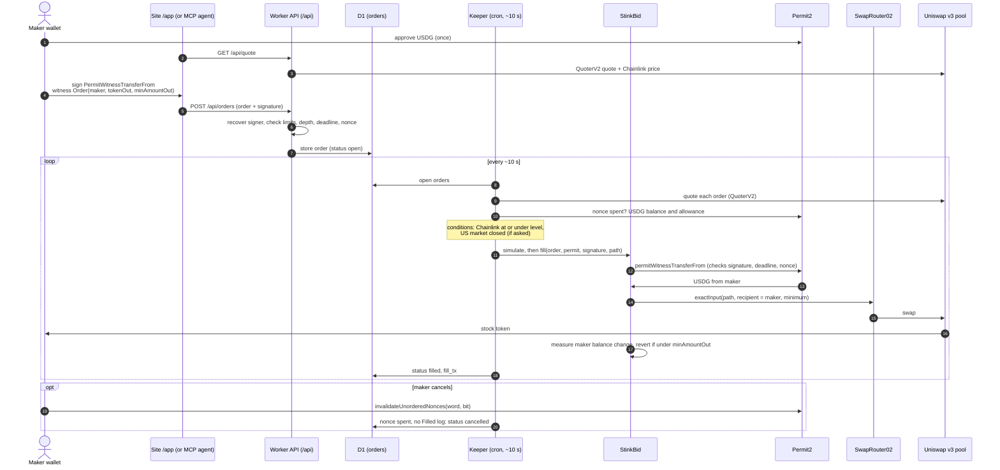

# Architecture

How a stink bid moves from a maker's wallet to a filled swap, and who holds what along the way. Addresses are on Robinhood Chain (4663) and listed in [README.md](README.md#contracts-robinhood-chain-4663) and [`shared/addresses.ts`](shared/addresses.ts).

## Flow

Anyone can call `StinkBid.fill`: `GET /api/orders/open` publishes active orders with their signatures and swap paths. The keeper is one filler among possible others. When a nonce is spent by someone else, the keeper looks for a `Filled` event from StinkBid (Blockscout log API) to tell a third-party fill from a cancel.

## Components

| Component | Code | Runs on | Does |
|---|---|---|---|
| Order page | [`src/app/`](src/app) | maker's browser | connects the wallet, sets the Permit2 approval, builds and signs the EIP-712 typed data, cancels by revoking the nonce |
| MCP server | [`worker/mcp.ts`](worker/mcp.ts) | Worker, `POST /api/mcp` | returns typed data for an agent to sign with its own wallet, then submits the signature to the same API |
| Order API | [`worker/orders.ts`](worker/orders.ts) | Cloudflare Worker | quotes, validates and stores signed orders, serves the open book and fills |
| Keeper | [`worker/keeper.ts`](worker/keeper.ts) | Worker cron, every minute, five passes | expires orders, checks balances, approvals, nonces and conditions, quotes, simulates, sends `fill` |
| Status | [`worker/status.ts`](worker/status.ts) | Worker, `GET /api/status` | keeper run log and chain state |
| Shared config | [`shared/config.ts`](shared/config.ts) | site, API and keeper | addresses, markets and pools, Chainlink feeds, EIP-712 types, limits, holder tiers, US market hours |
| StinkBid | [`contracts/src/StinkBid.sol`](contracts/src/StinkBid.sol) | Robinhood Chain | pulls USDG through Permit2, swaps it to the maker, enforces the minimum at the maker's wallet |
| Database | [`migrations/`](migrations) | Cloudflare D1 | `orders`, `keeper_runs`, rate limits, sign-in sessions |

## Who holds what

| Party | Holds | Can | Cannot |
|---|---|---|---|
| Maker wallet | USDG, the received stock tokens, the only key that signs orders | sign orders, cancel any order on-chain through Permit2, revoke the Permit2 approval | be filled below a signed minimum or for more than the signed amount |
| Permit2 | the maker's USDG approval (not the USDG) | move USDG only with a valid maker signature, once per nonce, before the deadline | move USDG to anyone but the signed spender, StinkBid |
| StinkBid | nothing between transactions; no owner, fee, pause or upgrade | swap a signed amount to the maker along a path from USDG to the signed token | keep tokens (it reverts unless all USDG is spent), change a signed order, choose the token |
| Keeper key `0x3A61…D312` | ETH for gas only, as a Worker secret | send `fill` for open orders, choose when and along which path from USDG to the signed token | move USDG without a signature, fill below a minimum, block a maker from cancelling |
| Worker API and D1 | signed orders and their signatures, IP hashes for rate limits | refuse or drop orders, decide which orders the keeper tries | create or change a signature; a dropped order can still be filled by anyone holding its signature |
| Any third party | whatever they hold | fill any published order at its signed terms | anything the keeper cannot |
| USDG and stock token issuers | their token contracts | restrict transfers, which makes fills revert | spend a maker's tokens through StinkBid |

[SECURITY.md](SECURITY.md) lists what the contract guarantees and the known risks, including fill timing and routing by the filler.

## Limits and conditions

The API, not the contract, enforces order limits: 1 to 100 USDG and 10 open orders per wallet (higher for $STINKBID holders, see `TIERS`), depth 1 to 50% under the quote, deadline up to 30 days. Optional conditions are also off-chain, checked by the keeper before it sends a fill:

- `fill_on: oracle`: the Chainlink feed must be at or under the level stored at signing.
- `session: closed`: fill only outside the NYSE regular session.

An order whose conditions do not hold is not listed at `/api/orders/open`, so its signature stays unpublished while it waits.
